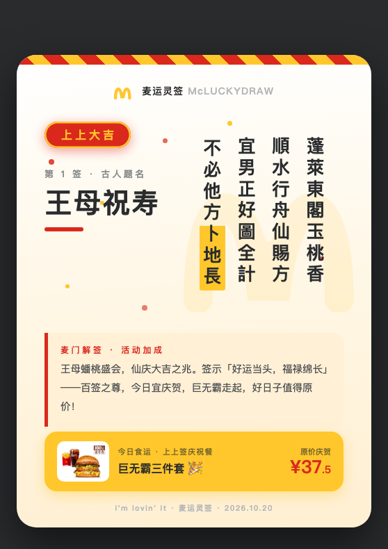
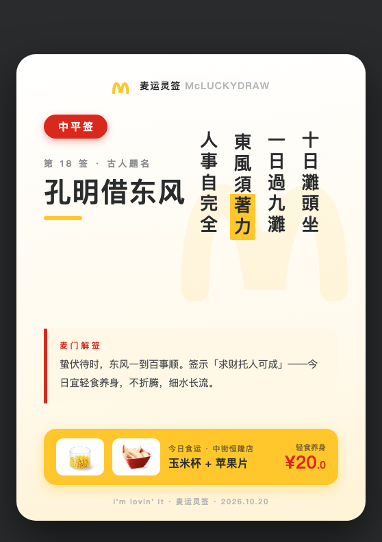

# 麦运灵签 McLuckyDraw 🍟🔮

> **吕祖灵签 × 麦当劳 MCP**：AI 抽签定今日运势，签文决定你吃什么。
> 上上签巨无霸庆祝，下签自动领券安抚 —— **天意即美味。**

<p align="center">
  
  &nbsp;&nbsp;
  
</p>

<p align="center"><i>左：第 1 签「王母祝寿」（上上大吉 → 巨无霸庆祝餐）· 右：第 18 签「孔明借东风」（中平 → 轻食养身）</i></p>

## 这是什么

一个基于**麦当劳中国官方 MCP Server** 开发的 WorkBuddy Skill。输入一句「帮我抽个签，看看今天吃什么」，它会：

1. 🥠 从**吕祖灵签 100 签**文库为你抽一支真签（签号、签诗、解曰、典故俱全）
2. 🎯 按签文吉凶等级（上上 / 上吉 / 中吉 / 中平 / 下下）映射成一套「麦门运势点餐策略」
3. 🍔 自动完成查附近门店 → 拉实时菜单 → 选品 → 领券/用券 → 含券计价 → 确认下单的**真实交易闭环**（下单前强制人工确认）
4. 🎴 生成一张麦当劳设计语言的可分享签文卡片（金拱门黄 × 麦当劳红，单文件 HTML，官方商品实拍图内联）

## 运势 × 点餐策略

| 签级 | 签文暗示 | 麦门策略 | 签级胶囊 |
|------|---------|---------|:---:|
| 上上 🔥 | 大吉大利，宜庆贺 | 招牌套餐庆祝 + 关联当日营销活动加成 | `上上大吉` 红底金边 |
| 上吉 ✨ | 好运正旺 | 招牌套餐 + 自动挑你账户里最优的券 | 红底 |
| 中吉 🌤 | 平稳向好 | 随心配 1+1 省钱组合 + 查可领优惠券 | 黄底 |
| 中平 🍃 | 宜稳健，忌冲动 | 轻食小食组合，细水长流 | 红底胶囊 |
| 下下 🌧 | 时运不济，需安抚 | 甜品安抚餐 + **一键领取全部可领优惠券**（麦门不弃你）+ 积分到期提醒 | 深灰底 |

策略映射按真实签库分布设计（100 签：上上 13 / 上吉 13 / 中吉 34 / 中平 28 / 下下 12），详见 `skills/mclucky/fortune/meal-mapping.json`。

## 工作原理

```
抽签（本地 100 签文库，真随机）
   │
   ▼
签级 → meal-mapping.json 策略匹配
   │
   ▼
now-time-info → query-nearby-stores → query-meals      （实时门店/菜单）
   │
策略分支：campaign-calendar（上上加成）｜query-my-coupons（上吉用券）
         ｜available-coupons（中吉可领）｜auto-bind-coupons（下下全领）
   │
   ▼
query-meal-detail → calculate-price（含券实价）
   │
   ▼
【人工确认门禁】→ create-order → 支付链接（演示订单可 cancel-order 回收）
   │
   ▼
签文卡片（单文件 HTML，官方商品图 base64 内联）
```

集成的麦当劳 MCP 工具清单、调用时序与业务价值详见 [MCP_INTEGRATION.md](MCP_INTEGRATION.md)。

## 安装

### 前置：配置麦当劳 MCP

1. 前往 [麦当劳 MCP 开放平台](https://open.mcd.cn/mcp) 注册并申请 MCP Token
2. 在 WorkBuddy【专家·技能·连接器】→【连接器】→ 右上角【自定义连接器】→【配置 MCP】，粘贴（替换 Token）：

```json
{
  "mcpServers": {
    "mcd-mcp": {
      "type": "streamablehttp",
      "url": "https://mcp.mcd.cn",
      "headers": {
        "Authorization": "Bearer YOUR_MCP_TOKEN"
      }
    }
  }
}
```

3. 保存后在自定义连接器中**信任/启用** mcd-mcp

### 安装本 Skill

将 `skills/mclucky/` 目录复制到 WorkBuddy 技能目录（`~/.workbuddy/skills/`），新开会话即可。

## 使用示例

```
你：帮我抽个签，看看今天吃什么

AI： 🔮 第 18 签 · 中平 ·「孔明借东风」
    十日滩头坐，一日过九滩
    东风须着力，人事自完全

    【麦门解签】蛰伏待时，东风一到百事顺。今日宜轻食养身。
    【今日食运】已锁定中街恒隆广场店（157m）实时菜单：
    玉米杯 ¥13 + 苹果片 ¥7 = ¥20.0，需要下单吗？

你：今天想抽个上上签沾沾喜气（再抽一次）

AI： 🎉 第 1 签 · 上上大吉 ·「王母祝寿」
    巨无霸三件套 ¥37.5 已就位——好日子值得原价！
```

## 目标用户

- 信玄学、玩梗、爱分享的年轻「麦门」信徒
- 选择困难症患者（把「今天吃什么」交给天意）
- 1024 程序员节想要一顿仪式感晚餐的开发者

## 仓库结构

```
README.md                  # 本文件
CONTEST_DECLARATION.md     # 参赛声明（官方原文，未改动）
MCP_INTEGRATION.md         # 麦当劳 MCP 工具集成说明
skills/mclucky/SKILL.md    # Skill 本体（WorkBuddy）
skills/mclucky/fortune/    # 吕祖灵签 100 签数据 + 运势→餐品策略映射
demo/                      # 签文卡片示例（HTML 源文件 + PNG 截图）
```

## 安全与合规

- MCP Token 仅存放于本地连接器配置，仓库不含任何真实凭证
- 所有下单操作前强制人工确认；演示订单一律 `cancel-order` 回收
- 签文库整理自公开渠道（算卜网 / 明师苑传统版核对），同作者的 [吕祖灵签在线站点](https://menglongfan.github.io/) 可体验完整解签
- 本项目为大赛参赛作品，非麦当劳官方产品；餐品与价格以麦当劳官方渠道实时结果为准

---

*i'm lovin' it · 麦运灵签 · 2026 麦当劳程序员节创意开发大赛参赛作品*
